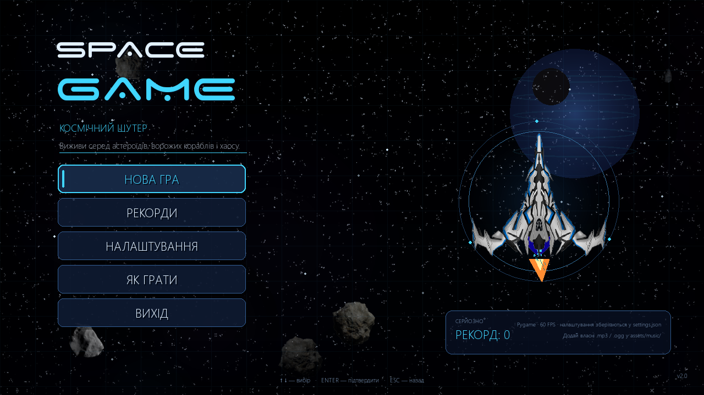
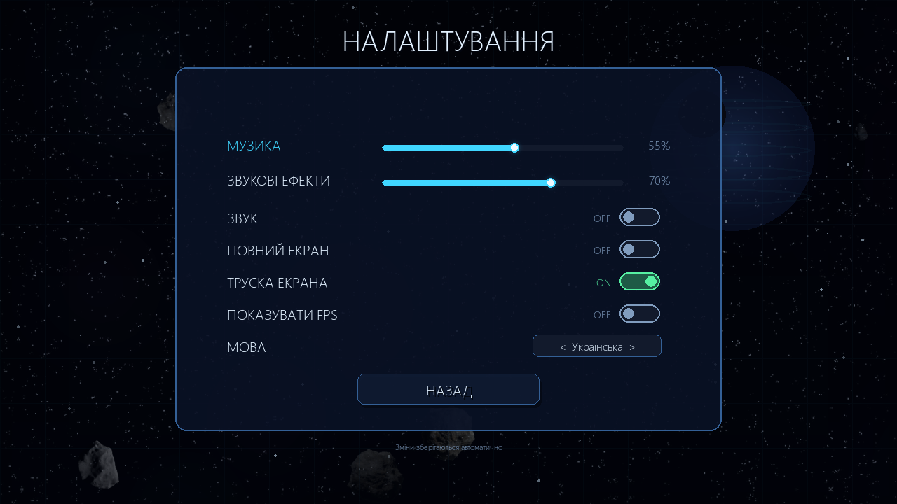
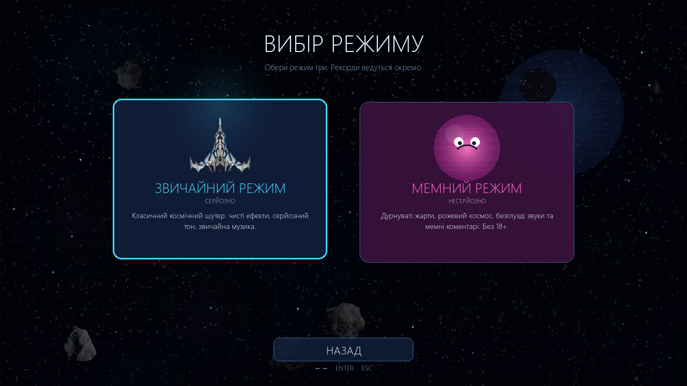
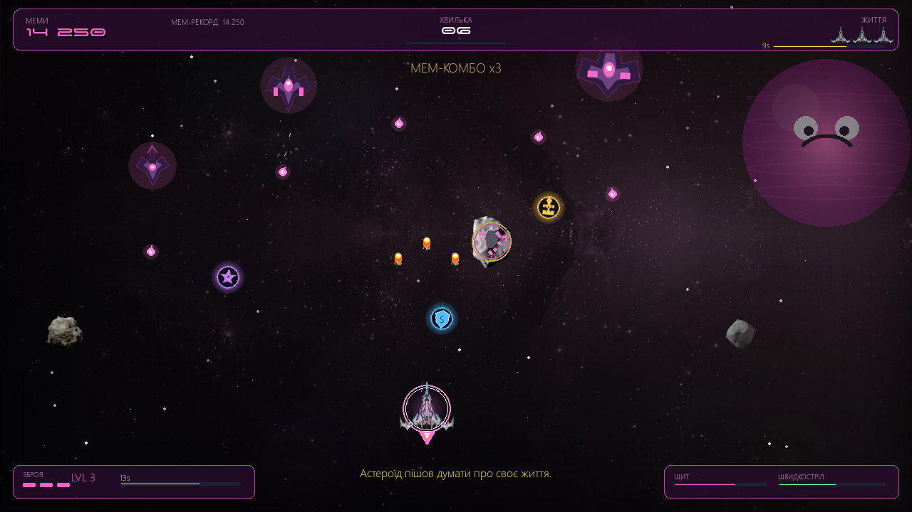
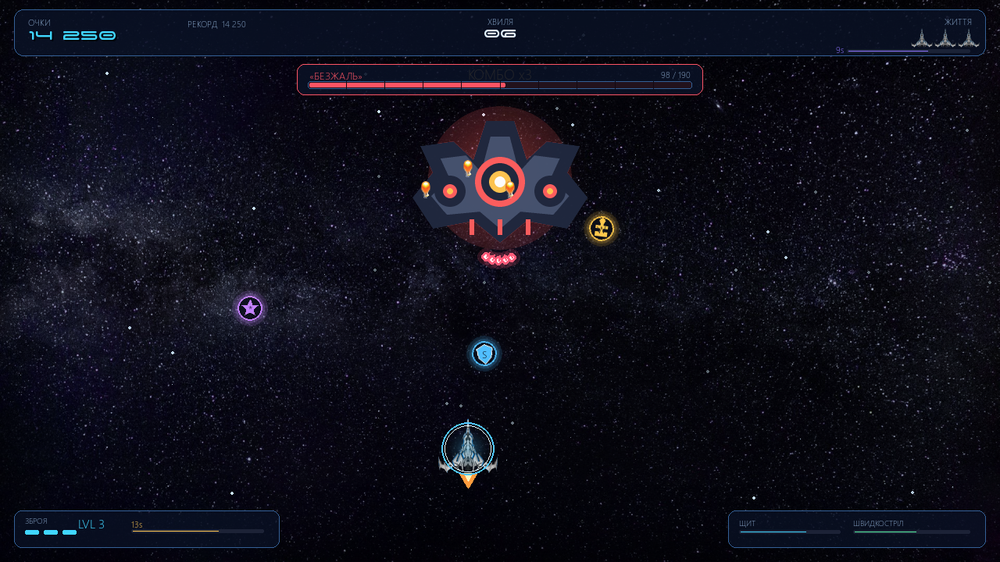
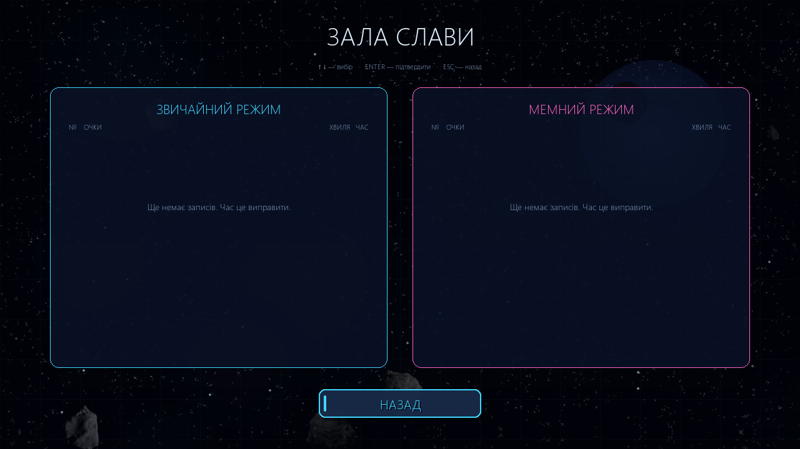
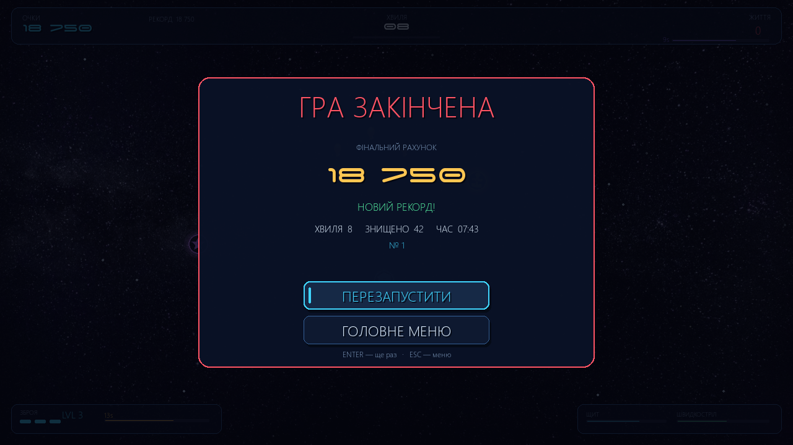

# SpaceGame — Cosmic Shooter

A 2D space shooter built with Python and Pygame. The project started as a
small joke game; this version turns it into a complete, polished arcade shooter
with menus, persistent settings, two distinct modes, enemy ships, bosses,
power-ups, particle effects and a local leaderboard.



## Features

- **Two playable modes**
  - **Normal** — classic sci-fi presentation, serious tone, normal soundtrack.
  - **Meme** — pink space, silly taunts, goofy procedural sounds and an optional
    folder for your own meme music. No adult content.
- **Full menu flow** — main menu, mode select, settings, leaderboard, controls,
  pause, restart, game over and quit. Every button works with both the keyboard
  and the mouse.
- **Modern HUD** — score, best score, wave, wave progress, lives, weapon level,
  active power-up timers, combo multiplier, boss health bar and optional FPS.
- **Effects** — parallax scrolling backgrounds, nebulas, twinkling stars,
  engine trails, muzzle sparks, hit flashes, explosions, shockwave rings, screen
  shake, damage flashes and floating score/loot text.
- **Enemies** — drifting asteroids that split when destroyed, plus scout,
  fighter and bomber ships with different movement and firing patterns. A
  multi-pattern dreadnought arrives every fifth wave.
- **Power-ups** — shield, extra life, weapon upgrade, rapid fire and bonus
  points. Weapon upgrades give double and triple shots; each timed bonus shows
  its remaining duration.
- **Progression** — increasing spawn rate and enemy health, combo multipliers,
  per-kill scores, a best score and a separate top-10 leaderboard per mode.
- **Settings** — music volume, SFX volume, mute, fullscreen/windowed, screen
  shake, FPS display and Ukrainian/English UI. Everything is saved to JSON and
  restored on the next launch.
- **Robustness** — fixed 1280×720 virtual canvas scaled with letterboxing to any
  window size; delta-time movement; cached assets; bounded projectile/enemy
  lists; safe handling of missing or corrupt settings, scores, fonts, images,
  music and audio devices.
- **Tests** — 64 automated headless tests covering storage, assets, audio
  fallbacks, physics, collisions, power-ups, bosses, game over, menus and
  display scaling.

## Requirements

- Python 3.10+ (tested with Python 3.14.2)
- [pygame-ce](https://pyga.me/) 2.5.8+ **or** pygame 2.5+
  - `pygame-ce` is a drop-in replacement and imports as `pygame`.
  - On Python 3.14, `pygame-ce` is currently the easiest option because the
    classic `pygame` package has no wheel for it.
- SDL audio is optional; the game runs silently if no audio device is available.

## Installation

```bash
git clone https://github.com/Trotsvitalya/SpaceGame.git
cd SpaceGame
python -m pip install -r requirements.txt
```

If you prefer a virtual environment:

```bash
python -m venv .venv
# Windows
.venv\Scripts\activate
# Linux / macOS
source .venv/bin/activate
python -m pip install -r requirements.txt
```

## Running

```bash
python MainGame.py
```

If fullscreen is inconvenient (or a monitor/resolution change causes trouble),
start in a window:

```bash
python MainGame.py --windowed
# or
python MainGame.py -w
```

The window starts at 1280×720 and is freely resizable. The game always renders
on a 1280×720 virtual canvas, so gameplay does not depend on the monitor size.

## Controls

| Action | Keys |
| --- | --- |
| Move | Arrow keys or `WASD` |
| Fire | `Space` (hold for autofire) |
| Pause / resume | `Esc` or `P` |
| Restart (pause or game over) | `R` or `Enter` |
| Main menu (pause or game over) | `M` or `Esc` |
| Fullscreen | `F11` |
| Menu navigation | Arrow keys / `WASD`, `Tab`, `Enter`, `Esc` |
| Menu mouse | Hover to focus, click to activate/drag |

On the mode-select screen, use left/right (or up/down) and `Enter`, or click a
mode card.

## Modes

### Normal

Classic arcade space shooter presentation. Blue/cyan UI, regular soundtrack,
straightforward enemy waves and a serious boss warning.

### Meme

The same core gameplay with a pink/purple palette, a cartoon planet, meme taunts
after kills, goofy sound effects and a built-in procedural meme loop. To use
your own music, drop audio files into `assets/music/Meme/` (see the README in
that folder). Invalid or unsupported files are skipped and never crash the
game. Meme mode contains no sexual content.

## Gameplay notes

- A new wave starts every 24 seconds and raises the difficulty.
- Every fifth wave spawns the dreadnought. Destroying it clears the screen,
  awards a large score bonus and drops weapon, shield and life power-ups.
- Consecutive kills build a combo. The multiplier rises up to ×5 and resets
  after a short pause between kills.
- Shields absorb one hit. Weapon upgrades last 18 seconds; rapid fire lasts
  11 seconds. Collecting a maxed-out bonus grants points instead.
- The player has three lives by default, can carry up to five, and respawns with
  brief invulnerability after losing one.
- Score and wave are shown on the game-over screen, along with rank and the best
  score for that mode.

## Settings and saved data

Settings and scores are stored as JSON in the game directory:

- `settings.json`
- `scores.json`

Both are ignored by Git. The game validates every field: missing files use safe
defaults, corrupt JSON is replaced with defaults, out-of-range volumes are
clamped, unknown languages/modes fall back to Ukrainian/Normal, and bad
leaderboard rows are skipped. Writes are atomic (temporary file + replace), so
an interrupted save cannot destroy the previous file.

For portable or test runs, set `SPACEGAME_CONFIG_DIR` to a different folder:

```bash
# Windows PowerShell
$env:SPACEGAME_CONFIG_DIR = "C:\temp\spacegame-config"
python MainGame.py
```

## Music and sounds

```text
assets/
├── music/
│   ├── BackgroundMenu.mp3      # main menu loop
│   ├── GameProcess/            # normal-mode playlist (mp3/ogg/wav/flac)
│   └── Meme/                   # optional meme playlist + README
├── sounds/                     # shot, crash and game-over effects
├── images/
│   ├── asteroids/              # asteroid sprites
│   ├── asteroidsBoom/          # explosion frames
│   ├── backgrounds/            # parallax backgrounds
│   ├── userBullets/            # player bullet frames
│   └── userStarShips/          # player ship frames
└── fonts/                      # bundled decorative font(s)
```

Music playback falls back gracefully:

1. The requested playlist/folder is scanned for supported audio files.
2. Broken tracks are skipped.
3. If the list is empty or entirely broken, Meme mode uses a generated
   procedural loop.
4. Normal mode can reuse the normal soundtrack; with no usable music at all the
   game continues silently.

## Project structure

| File | Responsibility |
| --- | --- |
| `MainGame.py` | Entry point and clean shutdown |
| `AppClass.py` | Display scaling, fullscreen, scene switching, fade transitions, main loop |
| `MenuClass.py` | Main menu, mode select, settings, leaderboard, controls, animated menu |
| `GameProcessClass.py` | Gameplay loop, waves, collisions, HUD, pause, game over |
| `UserShipClass.py` | Player movement, weapons, shields, lives, respawn |
| `EnemyAsteroidClass.py` | Asteroids, enemy ship types, boss |
| `BulletClass.py` | Player and enemy projectiles with swept collision data |
| `PowerUpClass.py` | Collectible bonuses |
| `EffectsClass.py` | Starfield, particles, explosions, screen shake |
| `ResourcesClass.py` | Cached images, fonts, procedural sprites, palettes |
| `AudioClass.py` | Music playlists, sound bank, safe fallbacks |
| `AudioSynth.py` | Procedural meme loop and synthesized SFX |
| `SettingsClass.py` | Settings and leaderboard persistence/validation |
| `Localization.py` | Ukrainian and English strings, meme taunts |
| `UIClass.py` | Buttons, sliders, toggles, choice widgets, panels, text |
| `utils.py` | Math, JSON, config-directory and formatting helpers |
| `tests/` | Headless unittest suite |

## Testing

The tests use SDL's dummy video/audio drivers and a temporary config directory,
so they never open a window, play sound or touch your real save files.

```bash
python -m unittest discover -s tests -v
```

Expected result: `Ran 64 tests ... OK`.

A quick syntax check of every module:

```bash
python -m py_compile AppClass.py AudioClass.py AudioSynth.py BulletClass.py \
    EffectsClass.py EnemyAsteroidClass.py GameProcessClass.py Localization.py \
    MainGame.py MenuClass.py PowerUpClass.py ResourcesClass.py \
    SettingsClass.py UIClass.py UserShipClass.py utils.py
```

The suite covers:

- settings roundtrip, corrupt/missing files, invalid values and atomic writes
- leaderboard sorting, truncation, legacy format and persistence
- asset/font/sprite caching, translation key parity and text wrapping
- audio file filtering, disabled audio and broken music files
- frame-rate-independent movement, playfield bounds, weapons, shields and respawn
- projectile limits, power-up pickup/expiry, swept collisions and asteroid splits
- all menu screens, keyboard and mouse actions, pause, boss waves and game over
- letterboxed viewport math and fade transitions

## Troubleshooting

- **`ModuleNotFoundError: pygame`** — install the requirements, and make sure the
  interpreter used to run the game is the same one used for `pip install`.
- **No sound** — check the OS mixer and the in-game `AUDIO` toggle. The game
  shows a note in Settings when audio is unavailable and keeps running.
- **Fullscreen/resolution issues** — launch with `--windowed`, resize the
  window, or press `F11` to toggle.
- **Cyrillic text looks like boxes** — the game picks a system font with
  Cyrillic support (Segoe UI, Tahoma, Arial, DejaVu Sans, Liberation Sans or
  Noto Sans). Install one of those or use English in Settings.
- **Reset settings/scores** — close the game and delete `settings.json` and/or
  `scores.json`; fresh defaults are created on the next launch.

## Screenshots

| | |
| --- | --- |
|  |  |
|  |  |
|  |  |

## License

See [LICENSE](LICENSE).
