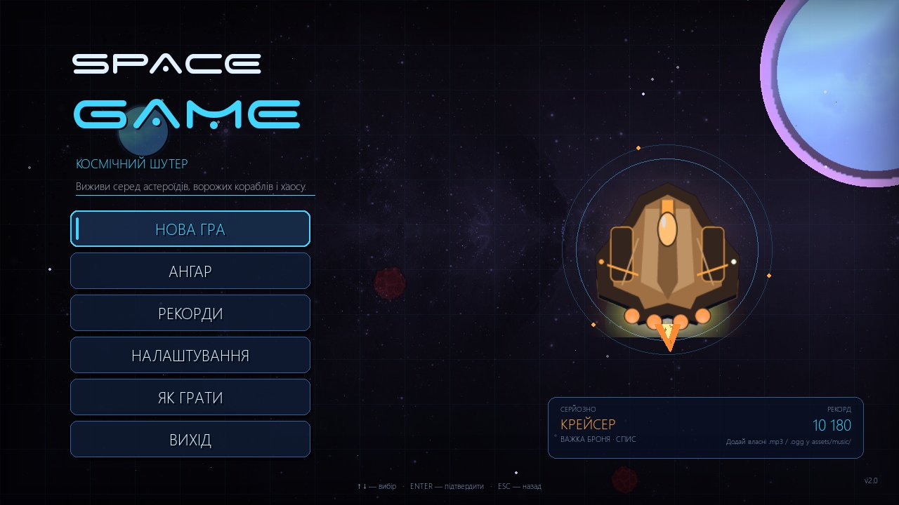
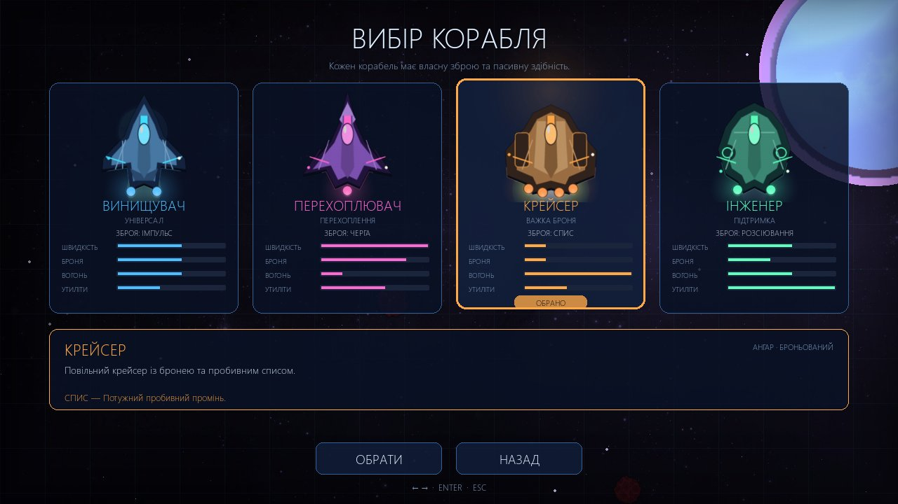
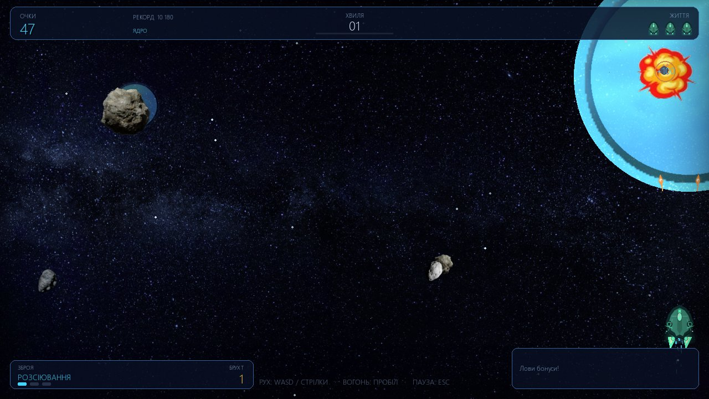
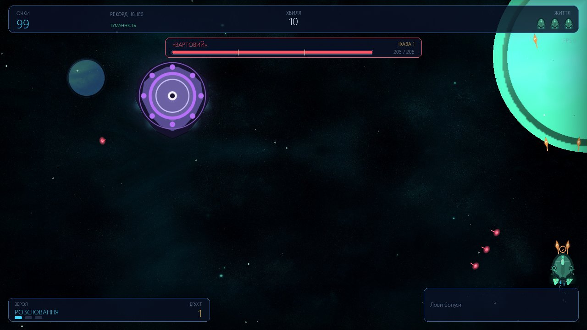
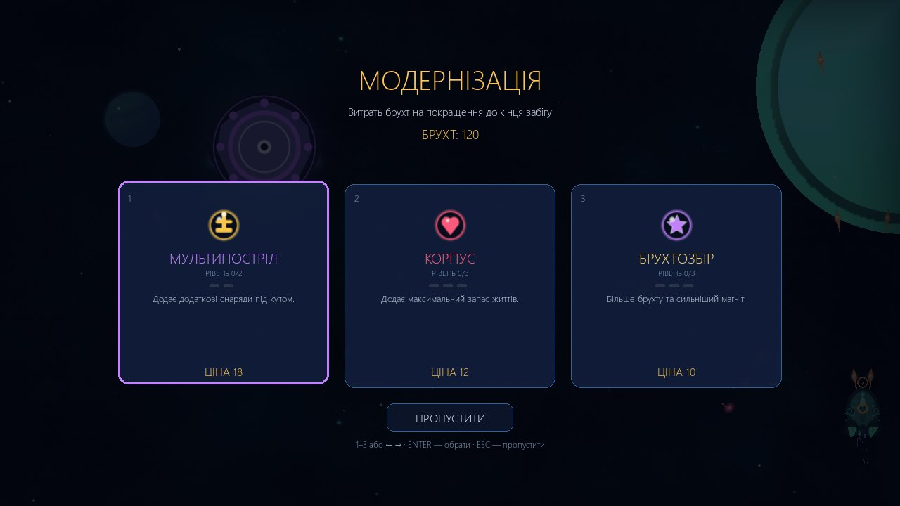
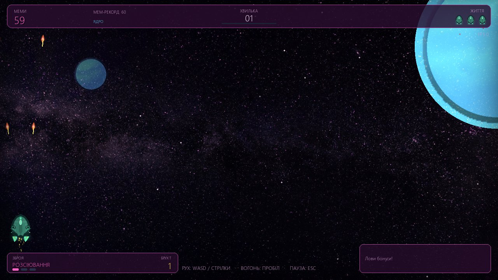
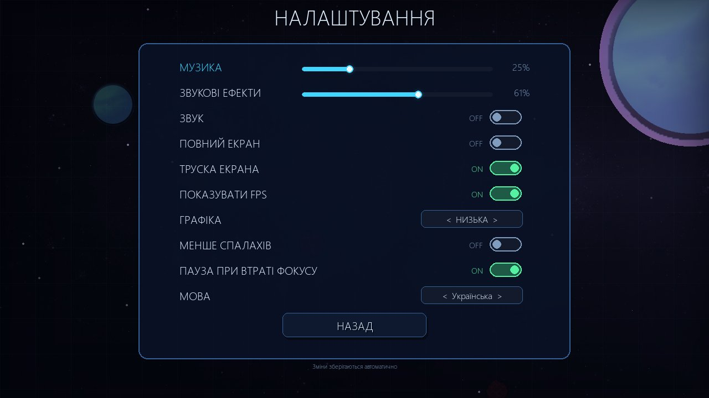
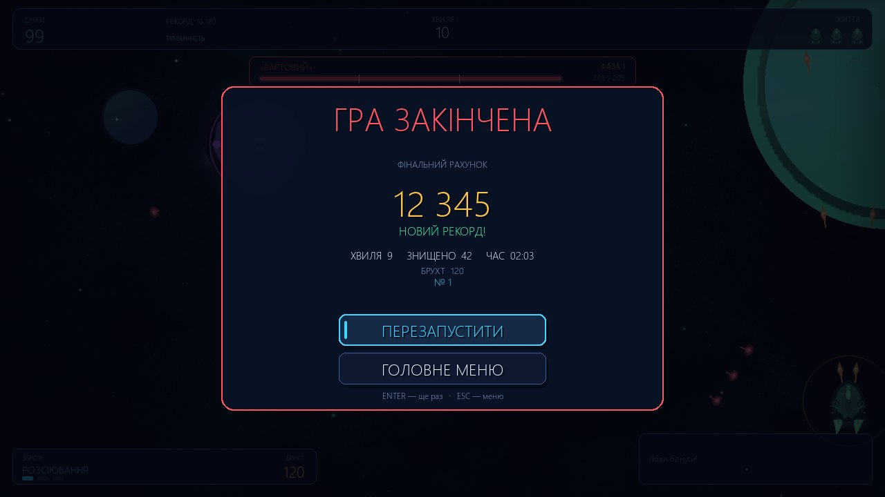

# SpaceGame 2.0 — Cosmic Shooter

A 2D arcade space shooter built with Python and Pygame. SpaceGame 2.0 expands
the original joke game into a complete arcade experience: a Hangar with four
real ship archetypes and weapon classes, multi-phase bosses, six upgrade paths,
rotating space zones, layered parallax art, synthesized combat audio,
accessibility options and a polished Ukrainian/English interface.



## What's new in 2.0

- **Hangar with four ships** — Fighter, Interceptor, Cruiser and Engineer, each
  with its own speed, armor, weapon and passive ability.
- **Four weapon classes** — pulse, burst, piercing lance and spread fan, with
  distinct projectile sprites and sounds.
- **Salvage progression** — every kill drops scrap; spend it on seven capped
  upgrade lines between selected waves and after bosses.
- **Multi-phase bosses** — the dreadnought and the sentinel telegraph beams,
  danger zones, minion waves and attack-pattern shifts at 66% and 33% health.
- **Rotating zones** — the Core, Verdant Nebula, Ember Reach and Void Gate each
  bring a new backdrop, palette and enemy composition every five waves.
- **Layered visuals** — parallax starfields, planets, nebulas, animated ship
  sprites, engine trails, hit sparks, shockwaves and reduced-flash support.
- **Expanded audio** — per-weapon fire sounds, boss phase stingers, hazard
  warnings, upgrade chimes, low-health alerts and safe silent fallbacks.
- **Accessibility** — reduced flashes, pause on focus loss, screen-shake toggle,
  three graphics-quality levels and full keyboard/mouse navigation.

## Features

- **Two playable modes**
  - **Normal** — classic sci-fi presentation, serious tone, normal soundtrack.
  - **Meme** — pink space, silly taunts, goofy procedural sounds and an optional
    folder for your own meme music. No adult content.
- **Full menu flow** — main menu, mode select, Hangar, leaderboard, settings,
  How to Play, pause, restart, game over and quit. Every screen works with both
  the keyboard and the mouse.
- **Modern HUD** — score, best score, wave, wave progress, lives, weapon class
  and level, active timed bonuses, combo multiplier, salvage counter, boss
  health/phase bar, zone name and optional FPS.
- **Effects** — parallax backdrops, planets, nebulas, twinkling stars, engine
  trails, muzzle sparks, hit flashes, explosions, shockwave rings, screen shake,
  damage flashes and floating score/loot text.
- **Enemies** — splitting asteroids plus scout, fighter, bomber, raider and
  elite ships with distinct movement, firing patterns and danger-zone attacks.
- **Power-ups** — shield, extra life, weapon upgrade, rapid fire and bonus
  points, each with its own generated icon.
- **Progression** — rising spawn rate and enemy health, combo multipliers up to
  ×5, per-kill scores, salvage upgrades, a best score and a separate top-10
  leaderboard per mode.
- **Settings** — music/SFX volume, mute, fullscreen, screen shake, FPS display,
  graphics quality, reduced flashes, pause on focus loss and Ukrainian/English
  UI. Everything is saved to JSON and restored on the next launch.
- **Robustness** — fixed 1280×720 virtual canvas scaled with letterboxing to any
  window size; delta-time movement; cached assets; bounded projectile, enemy and
  particle lists; safe handling of missing/corrupt settings, scores, fonts,
  images, music and audio devices.
- **Tests** — 93 automated headless tests covering storage, assets, audio
  fallbacks, physics, collisions, power-ups, hazards, bosses, upgrades, menus,
  accessibility and display scaling.

## Requirements

- Python 3.10+ (tested with Python 3.14.2)
- [pygame-ce](https://pyga.me/) 2.5.8+ **or** pygame 2.5+
  - `pygame-ce` is a drop-in replacement and imports as `pygame`.
  - On Python 3.14, `pygame-ce` is currently the easiest option because the
    classic `pygame` package has no wheel for it.
- SDL audio is optional; the game runs silently if no audio device is available.

## Installation

```bash
git clone https://github.com/Trotsvitalya/SpaceGame.git
cd SpaceGame
python -m pip install -r requirements.txt
```

If you prefer a virtual environment:

```bash
python -m venv .venv
# Windows
.venv\Scripts\activate
# Linux / macOS
source .venv/bin/activate
python -m pip install -r requirements.txt
```

## Running

```bash
python MainGame.py
```

If fullscreen is inconvenient (or a monitor/resolution change causes trouble),
start in a window:

```bash
python MainGame.py --windowed
# or
python MainGame.py -w
```

The window starts at 1280×720 and is freely resizable. The game always renders
on a 1280×720 virtual canvas, so gameplay does not depend on the monitor size.

## Controls

| Action | Keys |
| --- | --- |
| Move | Arrow keys or `WASD` |
| Fire | `Space` (hold for autofire) |
| Pause / resume | `Esc` or `P` |
| Restart (pause or game over) | `R` or `Enter` |
| Main menu (pause or game over) | `M` or `Esc` |
| Fullscreen | `F11` |
| Select upgrade | `1`–`3`, arrow keys + `Enter`, or click |
| Skip upgrade | `Esc` |
| Menu navigation | Arrow keys / `WASD`, `Tab`, `Enter`, `Esc` |
| Hangar navigation | Left/right (or `A`/`D`, `Tab`), `Enter` to select |
| Menu mouse | Hover to focus, click to activate/drag |

On the mode-select screen, use left/right (or up/down) and `Enter`, or click a
mode card. The ship chosen in the Hangar is used for the next run.

## Modes

### Normal

Classic arcade space-shooter presentation. Blue/cyan UI, regular soundtrack,
straightforward enemy waves and a serious boss warning.

### Meme

The same core gameplay with a pink/purple palette, a cartoon planet, meme taunts
after kills, goofy sound effects and a built-in procedural meme loop. To use
your own music, drop audio files into `assets/music/Meme/` (see the README in
that folder). Invalid or unsupported files are skipped and never crash the
game. Meme mode contains no adult content.

## Hangar: ships and weapons

Each hull pairs a weapon class with a passive ability. Stats are rated 1–5 and
shown in the Hangar.

| Ship | Role | Weapon | Passive | Speed | Armor | Firepower | Utility |
| --- | --- | --- | --- | --- | --- | --- | --- |
| **Fighter** | All-rounder | Pulse | Balanced | 3 | 3 | 3 | 2 |
| **Interceptor** | Intercept | Burst | Agile | 5 | 4 | 1 | 3 |
| **Cruiser** | Heavy armor | Lance | Armored | 1 | 1 | 5 | 2 |
| **Engineer** | Support | Spread | Salvage magnet | 3 | 2 | 3 | 5 |

- **Balanced** — the Fighter has no modifiers: a dependable baseline.
- **Agile** — the Interceptor gets 0.8 s of extra invulnerability after respawn.
- **Armored** — the Cruiser starts each life with 4 s of extra shield.
- **Salvage magnet** — the Engineer earns 25% more salvage and attracts pickups
  from a 185 px radius.

| Weapon | Ship | Behaviour |
| --- | --- | --- |
| **Pulse** | Fighter | Balanced, fast-firing shots; widens at levels 2–3. |
| **Burst** | Interceptor | Very fast twin repeater; three-shot spread at level 3. |
| **Lance** | Cruiser | Heavy piercing beam that passes through two targets. |
| **Spread** | Engineer | Wide fan of 2, 3 or 5 projectiles as it levels up. |

Weapon level is raised by the weapon power-up and lasts 18 seconds. The
multishot upgrade adds an angled pair to every volley (up to two pairs).

## Progression and upgrades

Destroying enemies awards **salvage** (asteroids 1, scouts 2, fighters 3, bombers
4, raiders and elites more) and builds a combo. Every fifth consecutive kill
raises the multiplier by one, up to ×5; the chain resets after 2.6 seconds
without a kill. Bosses award a large bonus plus 20 + wave salvage.

Upgrade offers appear after every third wave and after every boss. Choose one of
three random, still-available upgrades, or skip the offer.

| Upgrade | Max | Cost per level | Effect |
| --- | --- | --- | --- |
| Damage | 3 | 8 / 16 / 28 | +0.75 damage to every projectile. |
| Fire rate | 3 | 9 / 18 / 30 | 12% shorter delay between volleys per level. |
| Hull | 3 | 12 / 22 / 34 | +1 maximum life (and heals one). |
| Multishot | 2 | 18 / 34 | Adds an angled pair to every volley. |
| Engine | 3 | 8 / 15 / 24 | +9% top speed and acceleration per level. |
| Salvage | 3 | 10 / 18 / 28 | More scrap from kills and a stronger magnet. |
| Shield | 2 | 16 / 30 | Longer starting shield after respawn. |

Timed pickups: shield 12 s, rapid fire 11 s, weapon upgrade 18 s; extra lives
are permanent for the run.

## Zones, bosses and hazards

A new zone begins every five waves and cycles through four biomes:

| Waves | Zone | Backdrop | Enemy focus |
| --- | --- | --- | --- |
| 1–5 | The Core | Azure planet, blue stars | Scouts, fighters, bombers |
| 6–10 | Verdant Nebula | Green nebula | Raiders, elites, fighters |
| 11–15 | Ember Reach | Ember planet | Bombers, elites, raiders |
| 16–20 | Void Gate | Violet void | Raiders, elites, mixed |

Every fifth wave spawns a boss; the cycle repeats with scaling health.

| Boss | Waves | Identity | Patterns |
| --- | --- | --- | --- |
| **The Fearless** (dreadnought) | 5, 15, 25… | Red capital ship | Aimed fans and rings; phase 2 adds a sweeping beam and reinforcements; phase 3 adds danger-zone barrages. |
| **The Warden** (sentinel) | 10, 20, 30… | Violet ring ship | Spiral volleys and crossing beams; phases add arms, rotating beams and zones. |

Boss health is `95 + 11 × wave`. Attacks are telegraphed: beams and danger zones
show a warning circle/line before they become lethal, and phase changes flash a
banner and play a dedicated stinger. Elite ships also telegraph a danger zone
under the player's position.

## Gameplay notes

- A new wave starts every 24 seconds and raises the difficulty.
- Destroying a boss clears enemy fire and hazards, awards score and salvage,
  drops weapon/shield/life power-ups and advances the wave.
- Shields absorb one hit. Collecting a maxed-out bonus grants points instead.
- Default lives are ship-specific (Fighter 3, Interceptor 2, Cruiser 5,
  Engineer 3), can be raised by hull upgrades and respawn with brief
  invulnerability.
- Score, wave, kills, time and salvage are shown on the game-over screen, along
  with rank and the best score for that mode.

## Settings and saved data

Settings and scores are stored as JSON in the game directory:

- `settings.json`
- `scores.json`

Both are ignored by Git. The settings file is versioned (currently version 4);
older files are migrated automatically and gain safe defaults for new options.
The game validates every field: missing files use defaults, corrupt JSON is
replaced, out-of-range volumes are clamped, unknown languages/modes/ships fall
back to Ukrainian/Normal/Fighter, and bad leaderboard rows are skipped. Writes
are atomic (temporary file + replace), so an interrupted save cannot destroy the
previous file.

Accessibility options in Settings:

- **Reduced flashes** — full-screen flashes are toned down to 25%.
- **Pause on focus loss** — the game pauses when the window loses focus.
- **Screen shake** — can be disabled entirely.
- **Graphics quality** — Low/Medium/High controls particle budgets, parallax
  layers and detail.

For portable or test runs, set `SPACEGAME_CONFIG_DIR` to a different folder:

```bash
# Windows PowerShell
$env:SPACEGAME_CONFIG_DIR = "C:\temp\spacegame-config"
python MainGame.py
```

## Music and sounds

```text
assets/
├── music/
│   ├── BackgroundMenu.mp3      # main menu loop
│   ├── GameProcess/            # normal-mode playlist (mp3/ogg/wav/flac)
│   └── Meme/                   # optional meme playlist + README
├── sounds/                     # original shot, crash and game-over effects
├── images/
│   ├── asteroids/              # asteroid sprites
│   ├── asteroidsBoom/          # explosion frames
│   ├── backgrounds/            # parallax backgrounds
│   ├── bosses/                 # generated dreadnought/sentinel frames
│   ├── bullets/                # generated player/enemy projectile sprites
│   ├── enemies/                # generated enemy ship frames
│   ├── planets/                # generated planet art
│   ├── powerups/               # generated pickup icons
│   ├── ships/                  # generated player ship frames
│   ├── userBullets/            # legacy player bullet frames
│   └── userStarShips/          # legacy player ship frames
└── fonts/                      # bundled decorative font(s)
```

Music playback falls back gracefully:

1. The requested playlist/folder is scanned for supported audio files.
2. Broken tracks are skipped.
3. If the list is empty or entirely broken, Meme mode uses a generated
   procedural loop.
4. Normal mode can reuse the normal soundtrack; with no usable music at all the
   game continues silently.

Combat sound effects are synthesized at runtime by `AudioSynth.py` (weapon
fire, boss phases, hazards, upgrades, low health), so no external audio files
are required. Asset provenance and licensing are documented in
[ASSETS.md](ASSETS.md).

## Project structure

| File | Responsibility |
| --- | --- |
| `MainGame.py` | Entry point and clean shutdown |
| `AppClass.py` | Display scaling, fullscreen, scene switching, fade transitions, main loop |
| `MenuClass.py` | Main menu, mode select, Hangar, settings, leaderboard, controls, animated menu |
| `GameProcessClass.py` | Gameplay loop, waves, collisions, salvage/upgrades, HUD, pause, game over |
| `UserShipClass.py` | Ship archetypes, movement, weapon classes, upgrades, shields, lives |
| `EnemyAsteroidClass.py` | Asteroids, five enemy ship types, multi-phase bosses |
| `GameData.py` | Ships, weapons, upgrades, zones and boss tuning data |
| `Hazards.py` | Telegraphed danger zones and beam attacks |
| `SpaceBackdrop.py` | Layered parallax starfields, planets and nebulas |
| `BulletClass.py` | Player/enemy projectiles with swept collision data |
| `PowerUpClass.py` | Collectible bonuses and generated icons |
| `EffectsClass.py` | Particles, explosions, rings, screen shake, flash scaling |
| `ResourcesClass.py` | Cached images, fonts, generated fallbacks, palettes |
| `AudioClass.py` | Music playlists, sound bank, safe fallbacks |
| `AudioSynth.py` | Procedural meme loop and synthesized SFX |
| `SettingsClass.py` | Settings/leaderboard persistence, validation and migration |
| `Localization.py` | Ukrainian and English strings, meme taunts |
| `UIClass.py` | Buttons, sliders, toggles, choice widgets, panels, text |
| `utils.py` | Math, JSON, config-directory and formatting helpers |
| `tools/generate_assets.py` | Reproducible generator for the 2.0 sprite art |
| `tests/` | Headless unittest suite |

## Testing

The tests use SDL's dummy video/audio drivers and a temporary config directory,
so they never open a window, play sound or touch your real save files.

```bash
python -m unittest discover -s tests -v
```

Expected result: `Ran 93 tests ... OK`.

A quick syntax check of every module:

```bash
python -m py_compile AppClass.py AudioClass.py AudioSynth.py BulletClass.py \
    EffectsClass.py EnemyAsteroidClass.py GameData.py GameProcessClass.py \
    Hazards.py Localization.py MainGame.py MenuClass.py PowerUpClass.py \
    ResourcesClass.py SettingsClass.py SpaceBackdrop.py UIClass.py \
    UserShipClass.py utils.py tools/generate_assets.py
```

The suite covers:

- settings roundtrip, version migration, corrupt/missing files, invalid values
  and atomic writes
- leaderboard sorting, truncation, legacy format and persistence
- asset/font/sprite caching, translation key parity and text wrapping
- audio file filtering, disabled audio, broken music files, weapon sounds and
  pause/resume safety
- frame-rate-independent movement, playfield bounds, weapons, shields and respawn
- projectile limits, power-up pickup/expiry, swept collisions and asteroid splits
- danger zones, beams, boss phases, boss defeat flow and zone progression
- salvage spending, upgrade overlays, rejection and skipping
- all menu screens, Hangar selection, keyboard/mouse actions, pause, focus-loss
  auto-pause, reduced flashes, boss waves and game over
- letterboxed viewport math and fade transitions

## Performance

The game runs on a fixed 1280×720 canvas and caches loaded art, scaled surfaces
and fonts. The automated harness renders several thousand headless frames at
roughly 250–400 FPS with dummy SDL drivers; a longer soak that exercised waves
1–5, bosses, upgrades and deaths averaged about 167 FPS while drawing every
frame. On real hardware the frame limiter targets 60 FPS. Low graphics quality
reduces particle budgets, parallax layers and backdrop detail for weaker
machines.

## Troubleshooting

- **`ModuleNotFoundError: pygame`** — install the requirements, and make sure the
  interpreter used to run the game is the same one used for `pip install`.
- **No sound** — check the OS mixer and the in-game `AUDIO` toggle. The game
  shows a note in Settings when audio is unavailable and keeps running.
- **Fullscreen/resolution issues** — launch with `--windowed`, resize the
  window, or press `F11` to toggle.
- **Cyrillic text looks like boxes** — the game picks a system font with
  Cyrillic support (Segoe UI, Tahoma, Arial, DejaVu Sans, Liberation Sans or
  Noto Sans). Install one of those or use English in Settings.
- **Performance** — lower Graphics to Low and/or disable screen shake in
  Settings.
- **Reset settings/scores** — close the game and delete `settings.json` and/or
  `scores.json`; fresh defaults are created on the next launch.

## Screenshots

| | |
| --- | --- |
|  |  |
|  |  |
|  |  |
|  |  |

## License

The source code is released under the [Unlicense](LICENSE). Original 2.0 art
and synthesized sounds are likewise dedicated to the public domain. Pre-existing
third-party media keeps its original terms; see [ASSETS.md](ASSETS.md) before
redistributing those files.
