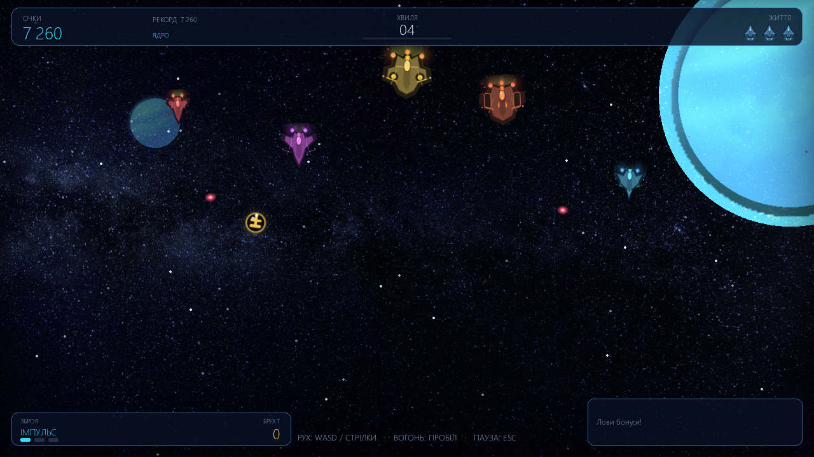
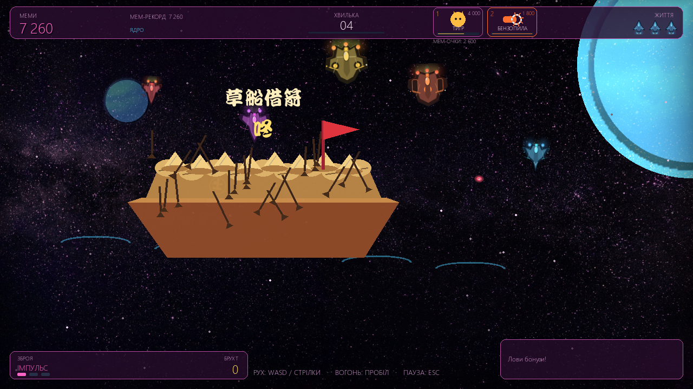
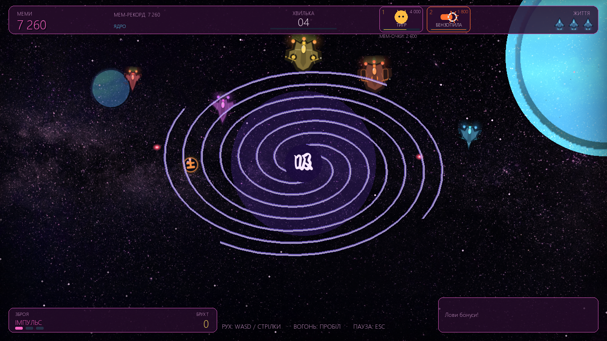
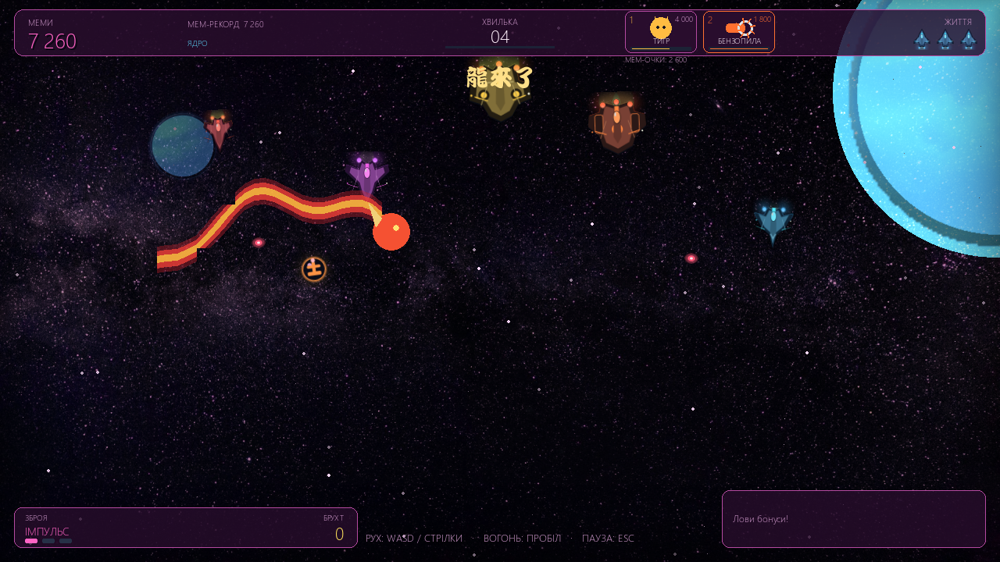
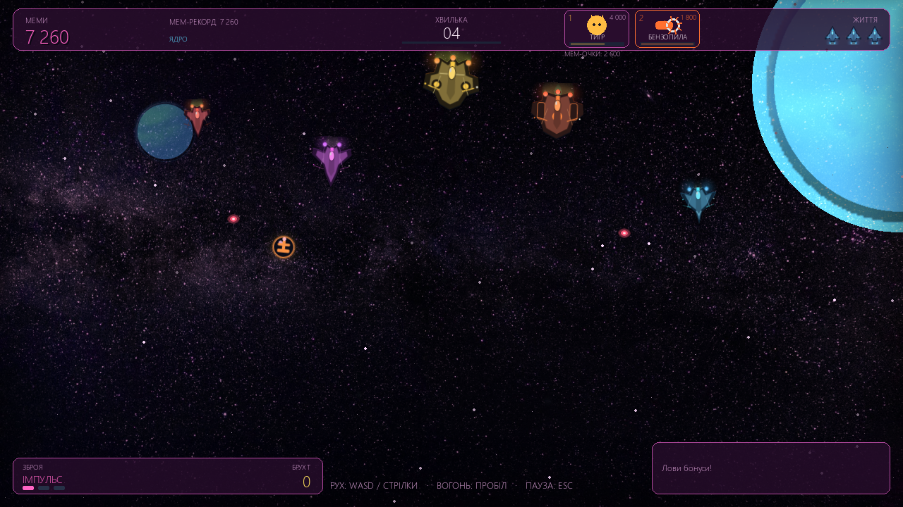
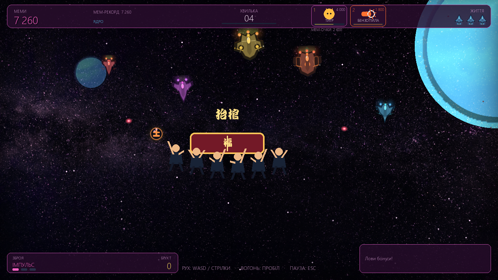
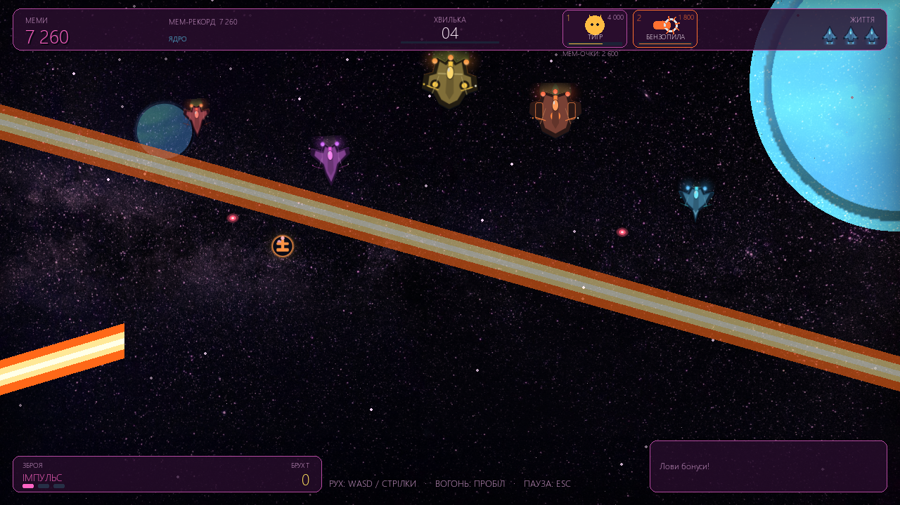
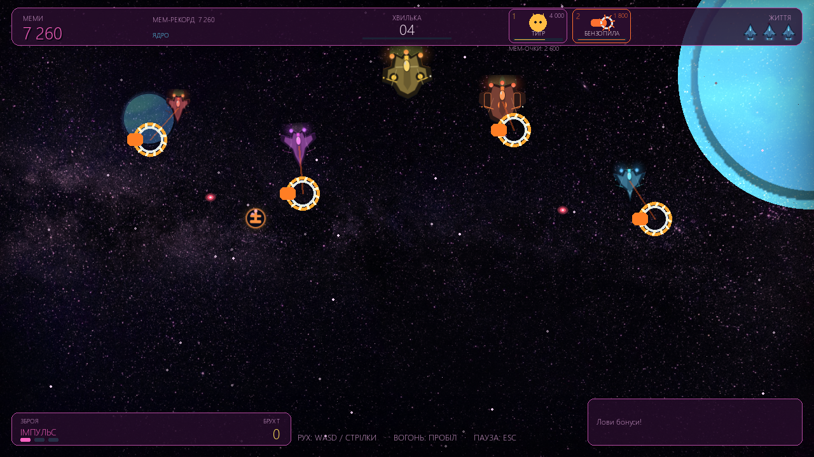

# SpaceGame — аркадний космічний шутер

English documentation: [README.md](README.md).

SpaceGame — 2D аркадний шутер на Python і Pygame. Гра має два режими, чотири кораблі, хвилі ворогів і босів, систему покращень, мем-події та український інтерфейс. Полотно гри має роздільність 1280×720. Цілочисельний масштаб зберігає чіткі піксельні краї, а дробовий (наприклад 1920×1080) використовує згладжування, щоб літери не ставали нерівномірно розтягнутими.

## Можливості

- **Режими гри:** нескінченні «Звичайний» і «Мемний», сюжетна кампанія з місіями та мережевий кооператив.
- **Чотири кораблі:** Винищувач, Перехоплювач, Крейсер та Інженер мають різні характеристики, зброю й пасивні здібності.
- **Зброя та прогрес:** чотири класи зброї, комбо-множник, уламки за ворогів і покращення між хвилями.
- **Вороги та боси:** астероїди, п'ять типів кораблів ворога, небезпечні зони, промені та боси з кількома фазами атак.
- **Мем-магазин:** накопичуйте мем-очки в мемному режимі, щоб купити заряд тигра або бензопили. Вартість: бензопила — 1 800, тигр — 4 000 мем-очок. Клавіша `1` купує/активує тигра, `2` — бензопилу: перше натискання купує заряд, наступне витрачає його.
- **Суперздібність тигра:** відео програється до кінця та зникає; після нього повертається звичайне освітлення, з'являються кігті й гра продовжується під час ударів.
- **Суперздібність бензопили:** коротка пауза й ефект розрізу екрана, потім чотири бензопили переслідують ворогів. Вороги тікають, не стріляють і не завдають шкоди гравцеві, поки триває переслідування.
- **Випадковий бонус бензопили:** може випасти у мемному режимі; зібраний бонус одразу запускає ефект.
- **Китайські мем-події:** «Солом'яний човен зі стрілами» (草船借箭) плавно пливе через екран; вороги й бос ціляться в човен, а поглинуті постріли додають стріли на палубу (до 100). Вихор-пилосос тягне предмети до центру; також є золотий дракон і червоні конверти з ієрогліфом «福».
- **Танець труни (抬棺):** після кожного 36-го знищеного ворога або кожного третього боса в мемному режимі з'являється процесія носіїв із труною. Повний трек Coffin Dance грає один раз, а процесія рухається до його завершення.
- **Звуки мем-подій:** при появі човна лунають китайський бойовий вигук, барабан і звук води; ураган має окрему сирену повітряної тривоги; для танцю труни грає власний електронний біт. Китайські голоси не звучать під час звичайного підбору бонусів.
- **Налаштування доступності:** гучність, повноекранний режим, тремтіння, якість графіки, зменшення спалахів, пауза при втраті фокуса та мова інтерфейсу.
- **Збереження:** налаштування і таблиці рекордів зберігаються у JSON; гра безпечно запускається за відсутності аудіо-пристрою чи частини графічних файлів.

## Кампанія та кооператив

У кампанії є послідовність сюжетних місій із завданнями, зонами, ворогами та босами. Завершення місії відкриває наступну й може дати постійний запас уламків; місії можна повторювати, обираючи складність. Результат невдалої спроби не змінює таблицю рекордів нескінченного режиму.

У меню «Мультиплеєр» можна створити гру як хост або приєднатися за IP-адресою та портом. Гра використовує локальну мережу або доступне пряме мережеве з'єднання; автоматичного сервера/матчмейкінгу немає. Хост керує симуляцією, а другий гравець підключається зі своїм кораблем. Обидва гравці бачать мем-події, торнадо та анімації суперздібностей. У мемному режимі партнер може натискати `1` і `2` для купівлі/активації здібностей; клавіша `P` ставить на паузу або відновлює спільну гру. Партнери можуть відроджувати одне одного, якщо підійдуть близько. Мережевий кооператив підтримує звичайні хвилі та кампанію.

## Вимоги та встановлення

Потрібен Python 3.10 або новіший та pygame-ce 2.5.8+ (або сумісний pygame 2.5+). Аудіо-пристрій необов'язковий.

```bash
git clone https://github.com/Trotsvitalya/SpaceGame.git
cd SpaceGame
python -m pip install -r requirements.txt
python MainGame.py
```

У Windows гру можна запустити у віконному режимі:

```powershell
python MainGame.py --windowed
```

Також працює скорочення `-w`. У «Налаштуваннях» можна вибрати роздільність дисплея / розмір вікна; зміна застосовується одразу й зберігається. Щоб змінити розмір вікна вручну, перетягніть його край. Клавіша `F11` перемикає повноекранний режим.

## Керування

| Дія | Клавіші |
| --- | --- |
| Рух | Стрілки або `WASD` |
| Стріляти | `Space` (утримувати для автоматичної стрільби) |
| Пауза / продовжити | `Esc` або `P` |
| Перезапуск | `R` або `Enter` на паузі чи екрані завершення |
| Головне меню | `M` або `Esc` на екрані завершення |
| Повноекранний режим | `F11` |
| Вибір покращення | `1`–`3`, стрілки й `Enter` або миша |
| Мем-магазин | `1` — тигр; `2` — бензопила (купівля, потім активація) |
| Меню та ангари | Стрілки / `WASD`, `Tab`, `Enter`, `Esc`; також миша |

У мемному режимі мем-очки нараховуються за набрані очки; ціна здібності списується з окремого гаманця, а не зі звичайного рахунку забігу. Смуга всередині картки показує наближення до ціни. Картка також показує наявні заряди.

## Режими гри

### Звичайний

Класичний космічний шутер із синьо-блакитним оформленням, хвилями та босами.

### Мемний

Мемний режим має власну палітру, репліки, звуки, музику та мем-очки. Кожні кілька секунд гра запускає одну з тематичних подій: човен збирає ворожі стріли, вихор притягує об'єкти до центру, дракон атакує ворогів, а червоні конверти можна збирати за бонусні очки. Мем-режим не містить контенту для дорослих.

Тигр може випасти під час звичайного випадіння предмета, якщо на екрані є щонайменше три живі вороги; шанс такого випадіння — 20%, з перезарядкою 18 секунд. Зібраний предмет запускає здібність одразу. Також тигра можна купити за 4 000 мем-очок. Для активації придбаного заряду натисніть `1`.

## Кораблі та зброя

| Корабель | Роль | Зброя | Пасивна здібність |
| --- | --- | --- | --- |
| Винищувач | Універсальний | Імпульсна | Збалансовані параметри |
| Перехоплювач | Маневрений | Черга | Додаткова невразливість після відродження |
| Крейсер | Броньований | Пробивний промінь | Додатковий щит після відродження |
| Інженер | Підтримка | Віяло пострілів | Більше уламків і магніт для бонусів |

Рівень тимчасової зброї підвищується відповідним бонусом. Покращення «Мультивистріл» додає до залпу додаткові снаряди.

## Хвилі, боси та покращення

Нова хвиля починається приблизно кожні 24 секунди. Кожна п'ята хвиля завершується босом; типи босів чергуються, а їхня міцність зростає з номером хвилі. Боси попереджають про промені й небезпечні зони до того, як атаки завдадуть шкоди.

За знищення ворогів нараховуються уламки та зростає серія комбо. Після кожної третьої хвилі й після боса можна вибрати одне з трьох доступних покращень або пропустити вибір:

| Покращення | Максимум рівнів | Ефект |
| --- | ---: | --- |
| Шкода | 3 | Збільшує шкоду пострілів |
| Швидкострільність | 3 | Скорочує затримку між залпами |
| Корпус | 3 | Додає максимальне життя й відновлює одне |
| Мультивистріл | 2 | Додає снаряди до залпу |
| Двигун | 3 | Підвищує швидкість і прискорення |
| Збір уламків | 3 | Збільшує здобич і радіус магніту |
| Щит | 2 | Подовжує щит після відродження |

Тимчасові бонуси: щит — 12 с, швидкострільність — 11 с, зброя — 18 с. Додаткові життя зберігаються до кінця забігу.

## Налаштування і дані

Файли `settings.json` і `scores.json` створюються в корені гри та не відстежуються Git. Щоб змінити директорію збережень (наприклад, для тестування), задайте змінну `SPACEGAME_CONFIG_DIR`:

```powershell
$env:SPACEGAME_CONFIG_DIR = "C:\temp\spacegame-config"
python MainGame.py
```

У налаштуваннях можна змінити гучність музики та ефектів, вимкнути звук, вибрати повноекранний режим і роздільність/розмір вікна, вимкнути тремтіння й спалахи, призупиняти гру при втраті фокуса, обрати якість графіки, складність та українську чи англійську мову.

## Музика й звук

У `assets/music/GameProcess/` можна розміщувати аудіо для звичайного режиму, а в `assets/music/Meme/` — власну музику мемного режиму. Підтримуються формати MP3, OGG, WAV і FLAC; пошкоджені файли пропускаються. Якщо немає доступних треків, гра продовжує роботу з процедурним музичним циклом або без звуку. Бойові та мемні ефекти генеруються в `AudioSynth.py`.

## Структура проєкту

| Файл / каталог | Призначення |
| --- | --- |
| `MainGame.py`, `AppClass.py` | Запуск гри, вікно, масштабування та перемикання сцен |
| `MenuClass.py`, `UIClass.py` | Меню, ангар, налаштування та віджети |
| `GameProcessClass.py` | Хвилі, зіткнення, магазин мем-сил, HUD і перебіг гри |
| `TigerUltimate.py`, `ChainsawUltimate.py` | Відео тигра, кігті та бензопила |
| `MemeEventSystem.py` | Китайські мем-події, човен, вихор і танець труни |
| `UserShipClass.py`, `EnemyAsteroidClass.py` | Гравець, вороги, боси й зброя |
| `GameData.py`, `Balance.py`, `CampaignData.py` | Параметри гри, баланс і кампанія |
| `ResourcesClass.py`, `SpaceBackdrop.py`, `EffectsClass.py` | Графіка, шрифти, фон і ефекти |
| `AudioClass.py`, `AudioSynth.py` | Музика й процедурні звуки |
| `SettingsClass.py`, `Localization.py` | Збереження та локалізація |
| `assets/` | Зображення, відео, шрифти, звуки та музика |
| `screenshots/` | Актуальні знімки екрана гри |
| `tests/` | Автоматичні модульні перевірки |

## Перевірка

Запуск тестів (SDL працює у фоновому режимі):

```bash
python -m unittest discover -s tests -v
```

Перевірка синтаксису модулів:

```bash
python -m py_compile *.py tools/*.py
```

Щоб перегенерувати знімки екрана, виконайте `python tools/capture_screenshots.py`. Для оновлення процедурних кораблів та іконок бонусів скористайтеся `python tools/generate_assets.py`.

## Знімки екрана

| Меню та налаштування | Гра й суперздібності |
| --- | --- |
|  |  |
|  |  |
|  |  |
|  |  |
|  |  |
|  |  |
|  |  |
|  | |

## Ліцензія й походження ресурсів

Код і нові процедурні ресурси поширюються за умовами [Unlicense](LICENSE). Раніше наявні зображення, музика й медіа зберігають свої початкові умови; файл [ASSETS.md](ASSETS.md) містить відомості про походження. Для відео тигра та шрифту `wt034.ttf` діють умови їхніх власників; включення у проєкт не змінює цих умов.
